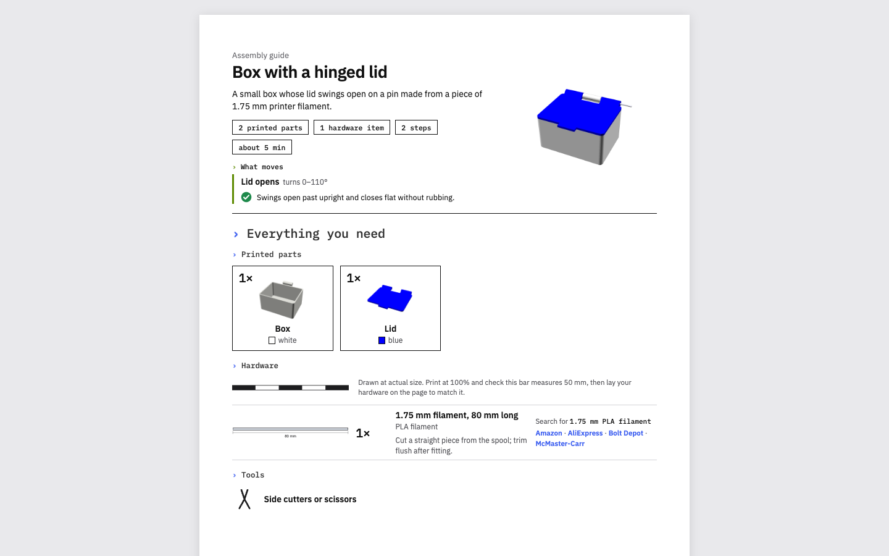
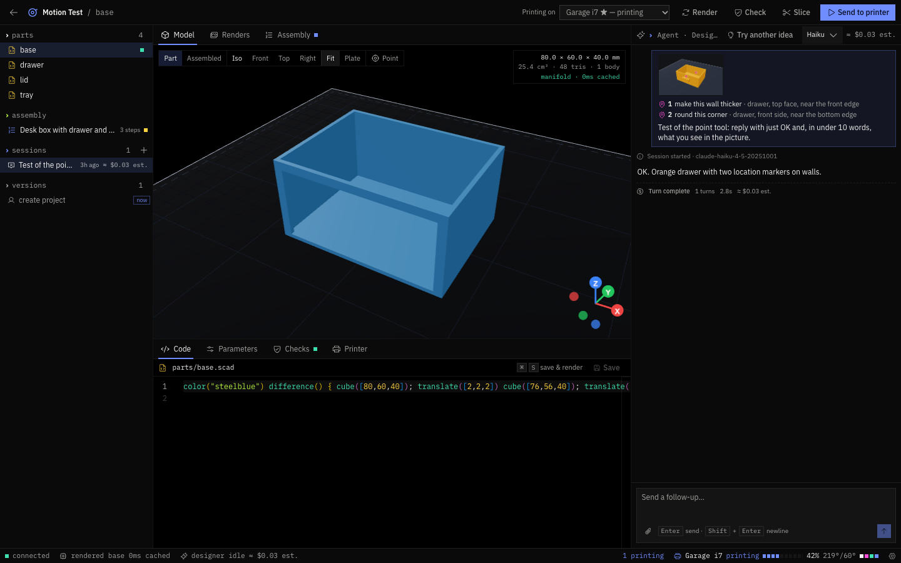
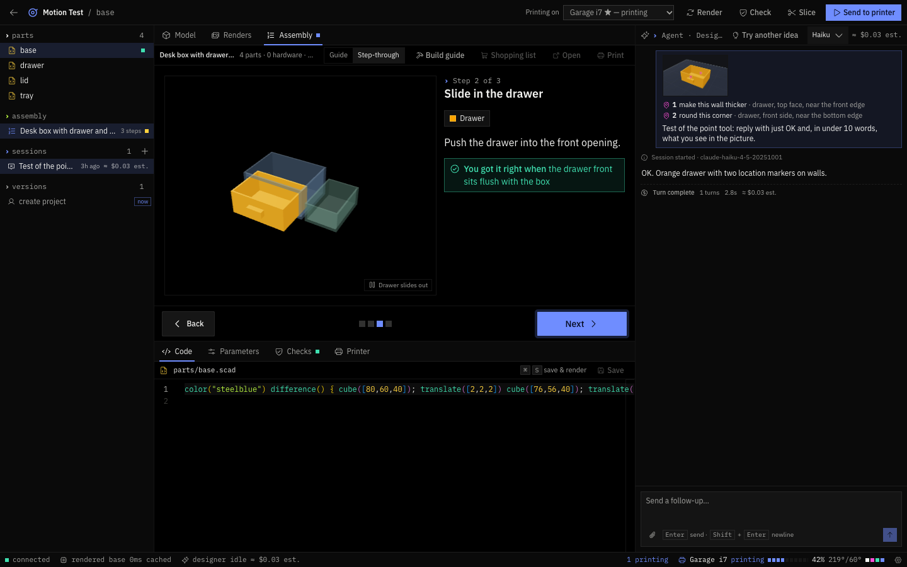

# Crease

**Describe it. Print it. Put it together.**

[Website](https://crease.plausible.ventures) · [Download for Mac](https://github.com/plausibleventures/crease/releases/latest) · Formerly Print Studio.



A desktop studio for 3D printing. Tell the designer what you want ("a box with a lid that swings open"). It asks a
couple of questions, designs the parts in OpenSCAD, checks they print and fit, slices them for your printer, and
prints them once you say so. When a build has more than one part you also get a parts list and a step-by-step
assembly guide like the one above. Everything stays an editable project on your computer.

| Design and check | Put it together |
|---|---|
|  |  |

## What it does

- **Design with an agent:** the designer (Claude Code, Codex or Grok, on your own account) writes OpenSCAD, looks at its own
  renders, and asks you questions with a recommended answer. You can edit the code and parameters yourself.
- **Check before printing:** solid geometry, fits the bed, first layer, overhangs, thin/tall parts, colours, and moving
  parts swept for collisions.
- **Assembly guides and shopping lists** for multi-part builds, with hardware drawn at real size.
- **Slice and print:** OrcaSlicer does the slicing (single or multicolour); the app sends the file to your printer only
  after you confirm, then shows progress and the camera.
- **Build packs:** export a project as one .zip (source, STLs, guide, parts list, checksums) and open it on another
  install. See [examples/](examples/).

## Status: alpha

Built by one person with a team of coding agents, used on one real printer. Expect rough edges.

- **One printer verified.** Real prints: Creality SPARKX i7 (Klipper/Moonraker, CFS). Other Moonraker printers are
  simulated or untested; Bambu, Prusa, OctoPrint and Marlin can't be sent to yet (save the print file instead). Full
  matrix: [docs/printer-support.md](docs/printer-support.md).
- **macOS on Apple silicon** is the only built installer (signed and notarized). Windows and Linux run from source
  only.
- **The designer needs Claude Code** (Anthropic's, free to install) plus an Anthropic API key, or your own Claude
  Code sign-in. It costs real money or plan usage per design; a simple part is cents, a multi-part build can be about
  a dollar on Sonnet.
- Known gaps and plans: [GitHub issues](https://github.com/plausibleventures/crease/issues).

## Requirements

| | |
|---|---|
| Computer | macOS 12+ on Apple silicon for the app; any OS with Node 22+ to run from source |
| [OpenSCAD](https://openscad.org/downloads.html#snapshots) | free; a 2024-or-newer development snapshot (the 2021 release is too old) |
| [OrcaSlicer](https://github.com/SoftFever/OrcaSlicer/releases/latest) | free; makes the print files |
| A designer | [Claude Code](https://code.claude.com/docs/en/setup) (recommended), or the Codex or Grok CLI; free to install, not included in the app |
| Claude access | an [Anthropic API key](https://console.anthropic.com/settings/keys) (billed per message by Anthropic), **or** your own Claude Code already signed in to your Claude plan |
| A printer (optional) | see [supported printers](docs/printer-support.md); without one, use the built-in practice printer |

## Install (macOS, Apple silicon)

1. Download `Crease-<version>-arm64.dmg` from [Releases](https://github.com/plausibleventures/crease/releases/latest),
   open it, drag **Crease** into Applications.
2. The setup screen checks Claude Code, OpenSCAD and OrcaSlicer and tells you how to fix each one. It finds the tools
   in `/Applications`, `~/Applications`, Homebrew or your PATH (Claude Code also in `~/.local/bin`); otherwise set
   the path in **Settings**.
3. **Claude:** paste an Anthropic API key (**Add an API key**). Already use Claude Code? Sign in to it yourself
   (open Terminal, type `claude`), press **Check again**, then **Use my Claude Code sign-in** to use your Claude plan
   instead. Crease never signs you in to Claude itself and never reads Claude Code's credential files; it asks
   `claude auth status`.
4. No printer yet? Pick the **practice printer** and print to it (simulated, nothing moves).

**Update:** replace the app with the new one. **Uninstall:** delete the app. Your projects stay in `~/Crease`
(`~/PrintStudio` if you used the app before it was renamed; delete the folder to remove them); app caches are in
`~/Library/Application Support/printstudio`; a saved API key is encrypted with the Keychain item
"printstudio Safe Storage". (Those two keep the old name on purpose: renaming them would lock saved keys.)

## Run from source

```sh
npm ci
npm run dev:electron   # desktop app (needs ports 5173/5174/7125 free)
npm run dev            # or: server + web UI at http://localhost:5173 + a fake printer on :7125
npm run check          # typecheck + lint + tests: must pass before every merge
npm run dist:mac       # build out/release/Crease-<version>-arm64.dmg
```

From source, the Agent SDK's own copy of the Claude Code binary (an optional npm dependency) runs the designer, so you
don't need a separate install; `PRINTSTUDIO_NO_BUNDLED_CLAUDE=1` makes it behave like the installer and use your own
Claude Code. The .dmg leaves that binary out (it's Anthropic's proprietary software, see the
[licence inventory](docs/licenses/INVENTORY.md) B2).

Code layout and conventions: [CLAUDE.md](CLAUDE.md). API contract: [shared/api.md](shared/api.md).

## Signing and notarization

Without the steps below, `npm run dist:mac` makes an ad-hoc signed app: it runs on your Mac, and other Macs warn
(right-click > **Open**). To make a release that opens with no warning, sign it with a Developer ID and notarize it.
You need a paid Apple Developer account. Do steps 1 to 3 once per Mac.

1. **Create the certificate.** Your Apple ID must have the **Account Holder** role (only that role can make a
   Developer ID certificate). In Xcode: **Xcode > Settings > Accounts**, pick your team, **Manage Certificates…**,
   **+**, **Developer ID Application**. Xcode puts it and its private key in your login keychain.
2. **Check it.** In Terminal:

   ```sh
   security find-identity -v -p codesigning
   ```

   One line must read `"Developer ID Application: Your Name (TEAMID)"`. `TEAMID` is your 10-character team ID (also
   on developer.apple.com > Account > Membership details).
3. **Save the notary password in the Keychain.** Make an app-specific password at
   [account.apple.com](https://account.apple.com) > **Sign-In and Security** > **App-Specific Passwords**. Then run
   this and paste that password when it asks (it is never stored in this repo):

   ```sh
   xcrun notarytool store-credentials crease-notary --apple-id you@example.com --team-id TEAMID
   ```

4. **Build, sign and notarize.** `CSC_NAME` is the certificate name from step 2 **without** the
   `Developer ID Application: ` prefix (electron-builder refuses it with the prefix):

   ```sh
   CSC_NAME="Your Name (TEAMID)" APPLE_KEYCHAIN_PROFILE=crease-notary npm run dist:mac
   ```

   Notarizing uploads the app to Apple and waits, usually a few minutes. If the profile is in a keychain other than
   the login keychain, also set `APPLE_KEYCHAIN=/path/to/that.keychain-db`.
5. **Verify.**

   ```sh
   spctl -a -vvv -t exec out/release/mac-arm64/Crease.app   # "accepted", "source=Notarized Developer ID"
   xcrun stapler validate out/release/mac-arm64/Crease.app  # "The validate action worked!"
   ```

   The .dmg itself is left unsigned (electron-builder's default); it opens without a warning because the app inside
   is notarized and stapled. `spctl -a -vvv -t install` checks installer packages and signed disk images, so on this
   unsigned .dmg it reports "no usable signature"; check the app as above instead.

Other ways to notarize, instead of `APPLE_KEYCHAIN_PROFILE`: `APPLE_ID` + `APPLE_APP_SPECIFIC_PASSWORD` +
`APPLE_TEAM_ID`, or an App Store Connect API key (`APPLE_API_KEY` = path to the .p8, `APPLE_API_KEY_ID`,
`APPLE_API_ISSUER`). A .p12 certificate works too (`CSC_LINK` + `CSC_KEY_PASSWORD`, for CI). The bundle id is
`ventures.plausible.crease` (override with `CREASE_APP_ID` for your own builds); released builds must never change it. Details: [electron-builder.config.cjs](electron-builder.config.cjs).

## Contributing

Bug reports, printer reports and design-quality reports are very welcome; see [CONTRIBUTING.md](CONTRIBUTING.md)
(including the safety rules for real printers) and [SECURITY.md](SECURITY.md) for vulnerabilities. Please follow the
[Code of Conduct](CODE_OF_CONDUCT.md).

## Licence

Crease is licensed under the [Apache License 2.0](LICENSE); see also [NOTICE](NOTICE). Contributions are
accepted under the same licence (see [CONTRIBUTING.md](CONTRIBUTING.md)).

Third-party components keep their own licences ([inventory](docs/licenses/INVENTORY.md),
[THIRD_PARTY_NOTICES.txt](THIRD_PARTY_NOTICES.txt)). In particular:

- `resources/slicer-profiles/` is **AGPL-3.0**, not Apache-2.0 (printer profiles derived from OrcaSlicer; see its
  [SOURCE.md](resources/slicer-profiles/SOURCE.md)).
- Claude Code is Anthropic's proprietary software. Crease doesn't include it; it runs the copy you installed.
  The Claude Agent SDK library the app loads is also Anthropic's, used under Anthropic's terms.

Crease is an independent project. It is not made or endorsed by Anthropic, Creality or the OpenSCAD and
OrcaSlicer projects.
